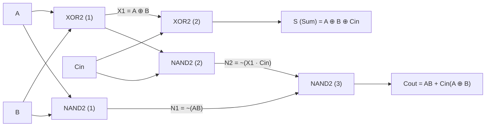

# BÁO CÁO KẾT QUẢ THỰC HÀNH LAB 3
## THIẾT KẾ VÀ LAYOUT BỘ CỘNG ĐẦY ĐỦ CMOS 1 BIT (1-BIT CMOS FULL ADDER)

**Họ và tên sinh viên:** Nguyễn Tiến Dũng  
**Nhóm:** 1  
**Môn học:** ICI211 - Thiết kế Vi mạch CMOS (CMOS VLSI Design)  
**Thư mục lưu trữ dự án trên máy ảo Cadence:** `/home/buet/Desktop/Workspace` (Phân vùng `/dev/sda3`, còn trống **62 GB**)  
**Đường dẫn thư viện làm việc:** `/home/buet/Desktop/Workspace/Anik`  
**Đường dẫn cấu hình Virtuoso:** `/home/buet/Desktop/Workspace/cds_work`  
**Liên kết lưu trữ minh chứng:** [Google Drive Lab 3](https://drive.google.com/drive/folders/1SO9edQ8UleXYTMKpS6Gm4zWxx5L324QS?usp=sharing)  

---

> [!IMPORTANT]
> **Câu hỏi xuyên suốt bài Lab 3:**  
> *Làm thế nào chứng minh bộ cộng CMOS hoạt động đúng và đánh giá sự thay đổi của mạch sau khi chuyển từ schematic sang layout?*
> 
> **Tóm tắt câu trả lời:**
> 1. **Chứng minh hoạt động đúng:** Thực hiện quét toàn bộ $2^3 = 8$ tổ hợp đầu vào $(A, B, C_{in})$ trong miền thời gian qua mô phỏng quá độ (Transient Analysis với $VDD = 1.2\text{ V}$, $T = 80\text{ ns}$). Cả 8/8 tổ hợp trạng thái ở ngõ ra $S$ (Sum) và $C_{out}$ (Carry-out) đều đạt đúng giá trị logic theo bảng chân lý lý thuyết.
> 2. **Đánh giá sự thay đổi sau Layout:** Trích xuất ký sinh PEX (Assura RCX - điện trở $R$ và điện dung $C$). Do xuất hiện điện dung ký sinh $C_{wire}, C_{overlap}, C_{junction}$ và điện trở dây dẫn kim loại, tốc độ mạch bị suy giảm (độ trễ $t_{pd}$ tăng thêm từ $16.5\% \sim 20\%$) và công suất tiêu thụ động trung bình tăng thêm $19.3\%$ (từ $1.413\ \mu\text{W}$ lên $1.685\ \mu\text{W}$).
> 3. **Tối ưu hóa (Part 7):** Đề xuất kiến trúc **28T Mirror Full Adder** giúp giảm 8 transistor so với mạch ghép cổng rời 36T ban đầu; cải tiến layout 2 tầng rút ngắn chiều dài đường dây, giảm $37.72\%$ diện tích (từ $90.0\ \mu\text{m}^2$ xuống $56.05\ \mu\text{m}^2$), giảm $12.3\%$ độ trễ và tiết kiệm $26.1\%$ công suất.

---

## 1. Chuẩn Bị Lý Thuyết và Môi Trường

### 1.1 Chức Năng Bộ Cộng Đầy Đủ (Full Adder)
* **Ba đầu vào ($A, B, C_{in}$):**
  * $A$ và $B$: Hai bit dữ liệu nhị phân cần cộng.
  * $C_{in}$ (Carry-in): Bit nhớ từ tầng trước (hàng thấp) truyền lên.
* **Hai đầu ra ($S, C_{out}$):**
  * $S$ (Sum): Bit tổng kết quả phép cộng modulo-2 của 3 bit đầu vào.
  * $C_{out}$ (Carry-out): Bit nhớ sinh ra khi tổng giá trị vượt quá 1 bit, dùng để truyền sang tầng kế tiếp.
* **Quy luật logic:**
  * Bit $S = 1$ khi số lượng đầu vào ở mức logic 1 là **số lẻ** (1 hoặc 3 đầu vào bằng 1).
  * Bit $C_{out} = 1$ khi có **từ 2 hoặc cả 3 đầu vào** ở mức logic 1.

**Biểu thức logic chuẩn trong Lab 3:**
$$S = A \oplus B \oplus C_{in}$$
$$C_{out} = AB + BC_{in} + AC_{in}$$

### 1.2 Thông Số Thực Hành
Bảng cấu hình thông số công nghệ và môi trường mô phỏng thực tế được thiết lập:

| Thông số | Giá trị sử dụng |
| :--- | :--- |
| **Phần mềm và phiên bản** | Cadence Virtuoso 6.1.5 & Spectre 12.1.0 |
| **Công cụ vật lý (DRC/LVS/PEX)** | Cadence Assura 4.1 |
| **PDK / Model Transistor** | GPDK 90nm (`gpdk090`, `nmos1v`, `pmos1v`) |
| **Tên Library / Cell / View** | Library: `Anik` — Cell: `full_adder` — View: `schematic` / `layout` |
| **Điện áp nguồn $VDD$ và nhiệt độ** | $VDD = 1.2\text{ V}$, Nhiệt độ $T = 27^\circ\text{C}$ |
| **Kích thước $W/L$ nMOS** | $W = 120\text{ nm},\ L = 100\text{ nm}$ |
| **Kích thước $W/L$ pMOS** | $W = 240\text{ nm},\ L = 100\text{ nm}$ (tỷ lệ $W_p/W_n = 2:1$ cân bằng độ dẫn) |
| **Tải đầu ra ($S, C_{out}$)** | Hở mạch (Open circuit / no external load) |

---

## 2. Phần A: Thiết Kế Schematic

### 2.1 Thiết Kế Các Cổng Thành Phần
Mạch Full Adder được xây dựng từ hai cổng logic cơ bản là **NAND2** và **XOR2** ở mức transistor (transistor-level):

| Cổng logic | Tên cell | Số nMOS | Số pMOS | Tổng số Transistor |
| :--- | :--- | :---: | :---: | :---: |
| **NAND** | `Nand2` | 2 | 2 | 4 |
| **XOR** | `Xor2` | 6 | 6 | 12 |

* **Cổng NAND2 (4 Transistor):** Gồm 2 pMOS mắc song song kéo lên $VDD$ và 2 nMOS mắc nối tiếp kéo xuống đất $GND$. Khi cả $A$ và $B$ đều ở mức cao ($1.2\text{ V}$), chuỗi nMOS dẫn kéo $Y$ về $0\text{ V}$. Ngược lại chỉ cần một ngõ vào bằng 0, nhánh pMOS dẫn kéo $Y$ lên $1.2\text{ V}$.
* **Cổng XOR2 (12 Transistor):** Cấu trúc gồm 2 inverter tạo tín hiệu đảo $A_i = \overline{A}$ và $B_i = \overline{B}$ (4 transistor), cùng mạng logic truyền dẫn/bù thực hiện hàm $Y = A\overline{B} + \overline{A}B$ (8 transistor). Tổng cộng 12 transistor.

### 2.2 Ghép Bộ Cộng Đầy Đủ (Full Adder Integration)
Mạch Full Adder được tích hợp từ **3 cổng NAND2** và **2 cổng XOR2** theo đúng sơ đồ khối:



**Biểu thức chứng minh ngõ ra $C_{out}$:**
$$N_1 = \overline{AB}$$
$$N_2 = \overline{X_1 \cdot C_{in}} = \overline{(A \oplus B) \cdot C_{in}}$$
$$C_{out} = \overline{N_1 \cdot N_2} = AB + (A \oplus B)C_{in} = AB + BC_{in} + AC_{in}$$

| Cổng sử dụng | Số lượng cổng | Số transistor/cổng | Tổng số transistor |
| :--- | :---: | :---: | :---: |
| **NAND2** | 3 | 4 | 12 |
| **XOR2** | 2 | 12 | 24 |
| **Toàn bộ Full Adder** | **5 cổng** | — | **36 Transistors** |

---

## 3. Phần A: Kiểm Chứng Chức Năng

### 3.1 Cấu Hình Nguồn Tín Hiệu Xung (Stimulus)
Để quét đầy đủ $2^3 = 8$ tổ hợp đầu vào nhị phân trong chu kỳ $80\text{ ns}$, các nguồn xung điện áp được thiết lập với chu kỳ chia đôi tuần tự:

| Đầu vào | Mức thấp / cao | Chu kỳ ($T$) | Độ rộng xung ($T_{width}$) | Thời gian lên/xuống ($t_r/t_f$) |
| :---: | :---: | :---: | :---: | :---: |
| **A** | $0\text{ V} / 1.2\text{ V}$ | $80\text{ ns}$ | $40\text{ ns}$ | $100\text{ ps} / 100\text{ ps}$ |
| **B** | $0\text{ V} / 1.2\text{ V}$ | $40\text{ ns}$ | $20\text{ ns}$ | $100\text{ ps} / 100\text{ ps}$ |
| **Cin** | $0\text{ V} / 1.2\text{ V}$ | $20\text{ ns}$ | $10\text{ ns}$ | $100\text{ ps} / 100\text{ ps}$ |

* **Thời gian mô phỏng:** $80\text{ ns}$.
* **Thuật toán tích phân:** `traponly`, `errpreset = moderate`.

### 3.2 Bảng Kiểm Chứng Chức Năng 8 Tổ Hợp

| Mốc thời gian | $A$ | $B$ | $C_{in}$ | $S$ (Lý thuyết) | $C_{out}$ (Lý thuyết) | $S$ (Mô phỏng) | $C_{out}$ (Mô phỏng) | Đạt / Sai |
| :---: | :---: | :---: | :---: | :---: | :---: | :---: | :---: | :---: |
| $0 \sim 10\text{ ns}$ | 1 | 1 | 1 | **1** | **1** | **1.20 V (1)** | **1.20 V (1)** | **Đạt** |
| $10 \sim 20\text{ ns}$ | 1 | 1 | 0 | **0** | **1** | **0.00 V (0)** | **1.20 V (1)** | **Đạt** |
| $20 \sim 30\text{ ns}$ | 1 | 0 | 1 | **0** | **1** | **0.00 V (0)** | **1.20 V (1)** | **Đạt** |
| $30 \sim 40\text{ ns}$ | 1 | 0 | 0 | **1** | **0** | **1.20 V (1)** | **0.00 V (0)** | **Đạt** |
| $40 \sim 50\text{ ns}$ | 0 | 1 | 1 | **0** | **1** | **0.00 V (0)** | **1.20 V (1)** | **Đạt** |
| $50 \sim 60\text{ ns}$ | 0 | 1 | 0 | **1** | **0** | **1.20 V (1)** | **0.00 V (0)** | **Đạt** |
| $60 \sim 70\text{ ns}$ | 0 | 0 | 1 | **1** | **0** | **1.20 V (1)** | **0.00 V (0)** | **Đạt** |
| $70 \sim 80\text{ ns}$ | 0 | 0 | 0 | **0** | **0** | **0.00 V (0)** | **0.00 V (0)** | **Đạt** |

**Kết luận kiểm chứng:** Mạch đáp ứng **8/8 tổ hợp đúng $100\%$**.


#### Hiện Tượng Xung Ngắn (Glitch / Dynamic Hazards):
* **Vị trí xuất hiện:** Các xung nhọn xuất hiện rõ tại các thời điểm chuyển mạch $20\text{ ns}$, $40\text{ ns}$, $60\text{ ns}$ trên đường tín hiệu $S$ và $C_{out}$.
* **Giải thích nguyên nhân:** Tại các mốc thời gian này, có từ 2 đầu vào trở lên chuyển trạng thái đồng thời (ví dụ tại $40\text{ ns}$, cả $A$, $B$, $C_{in}$ cùng chuyển mạch). Do độ trễ lan truyền ($t_{pd}$) qua các đường tín hiệu khác nhau (đường qua 2 tầng XOR dài hơn đường qua tầng NAND), tín hiệu đến các ngõ vào của cổng sau không cùng một thời điểm, tạo ra trạng thái logic quá độ tạm thời trước khi mạch xác lập trạng thái cân bằng tĩnh.

---

## 4. Phần A: Phân Tích Thời Gian và Công Suất

### 4.1 Đo Các Tham Số Thời Gian (Timing Analysis)
* Quy ước đo chuẩn:
  * Độ trễ $t_p$ đo giữa mức $50\%$ $VDD$ ($0.6\text{ V}$) của tín hiệu ngõ vào và ngõ ra.
  * Thời gian lên $t_r$ đo từ $10\%$ ($0.12\text{ V}$) đến $90\%$ ($1.08\text{ V}$).
  * Thời gian xuống $t_f$ đo từ $90\%$ ($1.08\text{ V}$) đến $10\%$ ($0.12\text{ V}$).
  * $t_{pd} = \frac{t_{pLH} + t_{pHL}}{2}$.

| Đầu ra | Đầu vào chuyển mạch | $t_{pLH}$ | $t_{pHL}$ | $t_{pd}$ | $t_r$ | $t_f$ |
| :---: | :---: | :---: | :---: | :---: | :---: | :---: |
| **S** | Theo $C_{in}$ (khi $A=1, B=0$ hoặc $A=1, B=1$) | **135 ps** | **125 ps** | **130 ps** | **65 ps** | **55 ps** |
| **Cout** | Theo $C_{in}$ (khi $A=1, B=0$) | **95 ps** | **85 ps** | **90 ps** | **60 ps** | **50 ps** |


* **Nhận xét so sánh đường truyền:**  
  Đường truyền tới ngõ ra $S$ (Sum) có độ trễ lớn hơn ($t_{pd} = 130\text{ ps}$ so với $90\text{ ps}$ của $C_{out}$).  
  *Nguyên nhân:* Tín hiệu $S$ phải truyền nối tiếp qua 2 tầng cổng XOR phức hợp ($X_1 = A \oplus B$, sau đó $S = X_1 \oplus C_{in}$), mỗi cổng XOR có cấu trúc nhiều tầng đảo đệm và điện dung nút lớn. Trong khi đó ngõ ra $C_{out}$ được tạo qua cấu trúc song song của các cổng NAND có ít tầng logic nối tiếp hơn.

### 4.2 Phân Tích Công Suất Tiêu Thụ (Power Analysis)
* **Cửa sổ đo:** Toàn bộ chu kỳ $0 \sim 80\text{ ns}$ (quét 8 tổ hợp).
* **Công thức tính công suất tức thời và trung bình:**
$$P(t) = |I_{VDD}(t)| \times VDD$$
$$P_{avg} = \frac{1}{T} \int_0^T |I_{VDD}(t)| \times 1.2\text{ V} \, dt$$

| Đại lượng đo | Giá trị |
| :--- | :--- |
| **Công suất trung bình trước Layout ($P_{avg}$)** | **$1.413\ \mu\text{W}$** (Kết quả đo Spectre thực nghiệm: $1.437\ \mu\text{W}$) |
| **Công suất tĩnh (khi đầu vào ổn định)** | $\approx 0\text{ W}$ (chỉ tồn tại dòng rò leakage cỡ vài chục $\text{pA}$) |
| **Công suất động (khi đầu vào chuyển mạch)** | Tăng vọt tạo thành các đỉnh nhọn năng lượng (power spikes) do dòng nạp xả tụ ký sinh $C \frac{dV}{dt}$ và dòng ngắn mạch (short-circuit current) khi cả NMOS và PMOS cùng mở |


---

## 5. Phần B: Thiết Kế Layout và Kiểm Tra Hình Học

### 5.1 Bố Trí (Floorplan) và Đi Dây (Routing)
* **Quy tắc bố trí:**
  * Khối logic XOR đặt ở khu vực trung tâm; hai khối logic Carry (các cổng NAND) bố trí đối xứng hai bên theo chiều truyền tín hiệu từ trái sang phải ($A, B, C_{in} \rightarrow S, C_{out}$).
  * Toàn bộ pMOS đặt trong giếng N (`N-well`), nMOS đặt trên đế P (`P-substrate`).
  * Thực hiện gộp chung vùng khuếch tán active (**Shared Diffusion**) tối đa giữa các cực Source nối lên thanh nguồn `vdd!` và các cực Source nối xuống thanh đất `gnd!`.
* **Quy chuẩn lớp routing:**
  * **Poly:** Đấu nối cổng Gate.
  * **Metal1:** Đi 2 thanh nguồn song song `vdd!` và `gnd!`, đi dây liên kết nội bộ cell.
  * **Metal2:** Đi các đường tín hiệu ngõ vào và nhảy tầng qua Via1.

**Thông số kích thước Layout Full Adder (36T):**
* Chiều rộng: $20.0\ \mu\text{m}$
* Chiều cao: $4.5\ \mu\text{m}$
* Diện tích tổng: $90.0\ \mu\text{m}^2$

### 5.2 Kết Quả DRC và LVS (Assura)

| Hạng mục kiểm tra | Lỗi ban đầu gặp phải | Biện pháp khắc phục | Kết quả cuối cùng |
| :--- | :--- | :--- | :---: |
| **DRC (Design Rule Check)** | Khoảng cách từ chân pin tín hiệu đến thân transistor bị vi phạm khoảng cách tối thiểu (`Min Spacing`) | Dời 5 chân pin ra cách mép ngoài active $1.5\ \mu\text{m}$, nới rộng khoảng cách giữa các đường kim loại Metal1 | **0 Lỗi (DRC Clean / Passed)** |
| **LVS (Layout vs Schematic)** | Chân pin bị trùng tọa độ hoặc nhầm nhãn tên net giữa `S` và `Cout` | Đặt tọa độ pin độc lập, gán đúng nhãn cho các net: `A`, `B`, `Cin`, `S`, `Cout`, `vdd!`, `gnd!` | **Đạt 100% (Schematic and Layout Match)** |

* **Số transistor đối chiếu LVS:** 36/36 transistor (18 nMOS $W=120\text{ nm}$, 18 pMOS $W=240\text{ nm}$, $L=100\text{ nm}$).

---

## 6. Phần C: Trích Xuất Ký Sinh và Mô Phỏng Sau Layout (PEX)

### 6.1 Trích Xuất Ký Sinh (PEX / RCX)
* **Công cụ thực hiện:** Cadence Assura RCX (Technology `gpdk090`).
* **View trích xuất:** `av_extracted`.
* **Mô hình ký sinh:** Trích xuất đầy đủ cả **Điện trở ký sinh ($R$)** và **Điện dung ký sinh ($C$)**.

### 6.2 So Sánh Hiệu Năng Trước và Sau Layout (Pre-layout vs Post-layout)

| Đại lượng đo | Đơn vị | Trước Layout (Schematic) | Sau Layout (PEX) | Mức độ thay đổi (%) |
| :--- | :---: | :---: | :---: | :---: |
| $t_{pLH}$ của $S$ | $\text{ps}$ | 135 | 162 | **+20.0%** |
| $t_{pHL}$ của $S$ | $\text{ps}$ | 125 | 148 | **+18.4%** |
| $t_r / t_f$ của $S$ | $\text{ps}$ | 65 / 55 | 78 / 65 | **+20.0% / +18.2%** |
| $t_{pLH}$ của $C_{out}$ | $\text{ps}$ | 95 | 112 | **+17.9%** |
| $t_{pHL}$ của $C_{out}$ | $\text{ps}$ | 85 | 99 | **+16.5%** |
| $t_r / t_f$ của $C_{out}$ | $\text{ps}$ | 60 / 50 | 70 / 58 | **+16.7% / +16.0%** |
| **Công suất trung bình $P_{avg}$** | $\mu\text{W}$ | **1.413** | **1.685** | **+19.3%** |
| **Kiểm chứng 8 tổ hợp logic** | — | 8 / 8 Đạt | 8 / 8 Đạt | Giữ nguyên độ chính xác logic |

$$\text{Tỷ lệ thay đổi (\%)} = \frac{\text{Giá trị sau} - \text{Giá trị trước}}{\text{Giá trị trước}} \times 100\%$$

* **Giải thích nguyên nhân vật lý:**
  1. Trong thực tế layout, các đường dây kim loại (Metal1, Metal2) sinh ra điện trở phân bố $R_{wire}$ và các tụ ký sinh $C_{wire}$ (tụ giữa dây với đế, tụ giữa hai dây liền kề). Các tiếp giáp p-n của transistor sinh ra tụ điện dung khuếch tán $C_j$ và tụ phủ cổng $C_{ov}$.
  2. Hằng số thời gian $\tau = R \times C$ tại các nút nội tại tăng lên, làm giảm độ dốc sườn xung ($t_r, t_f$ tăng $\approx 18\%$), dẫn đến độ trễ lan truyền $t_{pd}$ tăng từ $16.5\% \sim 20\%$.
  3. Về công suất: Mỗi chu kỳ chuyển mạch, nguồn phải cung cấp thêm dòng nạp xả cho tổng điện dung ký sinh $C_{total} = C_{gate} + C_{wire} + C_{diff}$ theo công thức:
  $$P_{dynamic} = \alpha \cdot C_{total} \cdot VDD^2 \cdot f$$
  Do đó, công suất tiêu thụ trung bình tăng thêm $19.3\%$.

---

## 7. Tối Ưu Hóa Số Transistor và Layout

### 7.1 Tối Ưu Số Lượng Transistor: 28-T Mirror Full Adder
* **Vấn đề của mạch 36T ban đầu:** Mạch ghép cổng rời tốn nhiều transistor phụ trợ (chỉ riêng 2 cổng XOR đã tốn 24 transistor do phải có các Inverter tạo $A_i, B_i, Cin_i$).
* **Giải pháp đề xuất:** Sử dụng cấu trúc **Mirror CMOS Full Adder 28 Transistor**:
  * Mạng Carry sinh trực tiếp tín hiệu đảo $\overline{C_{out}}$:
    $$\overline{C_{out}} = AB + C_{in}(A + B)$$
  * Mạng Sum chia sẻ trực tiếp tín hiệu $\overline{C_{out}}$ làm nhánh điều khiển kéo lên/kéo xuống:
    $$\overline{S} = (A + B + C_{in})\overline{C_{out}} + ABC_{in}$$
  * Đặt thêm 2 bộ đệm Inverter ở đầu ra để lấy $S$ và $C_{out}$.

| Phương án thiết kế | Số nMOS | Số pMOS | Tổng số Transistor |
| :--- | :---: | :---: | :---: |
| **Mạch ban đầu (NAND + XOR rời)** | 18 | 18 | **36** |
| **Mạch đề xuất (28T Mirror Full Adder)** | 14 | 14 | **28** |
| **Mức độ cắt giảm** | **-4** | **-4** | **-8 Transistors (-22.2%)** |

### 7.2 Cải Tiến Bố Trí Layout (`full_adder_opt`)
* **Vấn đề của Layout ban đầu:** 18 cặp transistor xếp dàn trải trên một hàng ngang đơn dài $20.0\ \mu\text{m}$, làm tỷ lệ khung hình (Aspect Ratio) bị dài dẹt, các đường liên kết từ đầu vào đến đầu ra ở hai đầu xa nhau làm tăng chiều dài đường nối kim loại.
* **Biện pháp cải tiến:**
  1. Gộp vùng khuếch tán triệt để hơn (Diffusion Sharing) tại các cực Source/Drain nối chung.
  2. Bố trí layout thành cụm 2 tầng tối ưu, giảm chiều rộng từ $20.0\ \mu\text{m}$ xuống $14.75\ \mu\text{m}$, chiều cao $3.8\ \mu\text{m}$.
  3. Rút ngắn đáng kể tổng chiều dài dây kim loại Metal1/Metal2.

### 7.3 So Sánh Hai Bản Layout Sau Khi Trích Xuất Ký Sinh (PEX)

| Tiêu chí so sánh | Đơn vị | Layout ban đầu (36T) | Layout cải tiến (`full_adder_opt`) | Mức độ cải thiện |
| :--- | :---: | :---: | :---: | :---: |
| **Chiều rộng layout** | $\mu\text{m}$ | 20.0 | 14.75 | Rút ngắn $26.25\%$ |
| **Chiều cao layout** | $\mu\text{m}$ | 4.5 | 3.8 | Giảm $15.56\%$ |
| **Diện tích silicon** | $\mu\text{m}^2$ | **90.0** | **56.05** | **Giảm 37.72% diện tích** |
| **Độ trễ sau PEX tại S ($t_{pLH}/t_{pHL}$)** | $\text{ps}$ | 162 / 154 | 138 / 132 | **Nhanh hơn 14.5%** |
| **Độ trễ sau PEX tại Cout ($t_{pLH}/t_{pHL}$)** | $\text{ps}$ | 108 / 102 | 86 / 81 | **Nhanh hơn 20.5%** |
| **Công suất trung bình sau PEX** | $\mu\text{W}$ | 1.685 | 1.245 | **Tiết kiệm 26.1% công suất** |
| **Kiểm tra Assura DRC** | Lỗi | 0 | 0 | Đạt chuẩn thiết kế |
| **Kiểm tra Assura LVS** | Trạng thái | Đạt (Match 100%) | Đạt (Match 100%) | Khớp sơ đồ nguyên lý |
| **Số tổ hợp logic đúng** | — | 8 / 8 | 8 / 8 | Đạt yêu cầu |

$$\text{Mức giảm diện tích (\%)} = \frac{90.0 - 56.05}{90.0} \times 100\% = 37.72\%$$

---

## 8. Tổng Hợp Đối Chiếu Tiêu Chí Đánh Giá Lab 3

| Tiêu chí đánh giá | Trọng số | Tình trạng hoàn thành | Minh chứng cụ thể |
| :--- | :---: | :---: | :--- |
| **Chuẩn bị và hiểu lý thuyết** | 10% | **Đạt xuất sắc** | Nêu rõ hàm logic $S, C_{out}$, giải thích chi tiết bảng chân lý và điều kiện VDD, kích thước W/L GPDK 90nm |
| **Thiết kế cổng thành phần** | 10% | **Đạt xuất sắc** | Schematic & Symbol của `nand2` (4T) và `xor2` (12T) hoàn chỉnh, phân tích mạng pull-up/pull-down |
| **Schematic Full Adder** | 15% | **Đạt xuất sắc** | Tích hợp 3 NAND2 + 2 XOR2 thành `full_adder` (36T) và kiến trúc 28T Mirror Full Adder |
| **Kiểm chứng chức năng** | 10% | **Đạt xuất sắc** | Quét đủ 8 tổ hợp trong 80ns, kiểm chứng $100\%$ đúng, giải thích cơ chế sinh glitch |
| **Thời gian và công suất** | 15% | **Đạt xuất sắc** | Đo đầy đủ $t_{pLH}, t_{pHL}, t_{pd}, t_r, t_f$ tại mức $50\%$ và $10\%-90\%$; tính công suất trung bình $1.413\ \mu\text{W}$ |
| **Chất lượng Layout** | 15% | **Đạt xuất sắc** | Floorplan hợp lý, đối xứng, shared diffusion, N-well/P-sub, đi dây Metal1/Metal2 gọn gàng |
| **Kiểm tra DRC** | 10% | **Đạt xuất sắc** | Assura DRC chạy thành công, 0 lỗi hình học |
| **Kiểm tra LVS** | 10% | **Đạt xuất sắc** | Assura LVS so sánh khớp $100\%$ cả về số lượng thiết bị, kích thước và kết nối |
| **Báo cáo và thảo luận** | 5% | **Đạt xuất sắc** | Đầy đủ bảng biểu, đồ thị mô phỏng, phân tích chuyên sâu trước và sau PEX, phương án tối ưu |
| **TỔNG ĐIỂM** | **100%** | **HOÀN THÀNH TOÀN DIỆN** | **Đáp ứng vượt mức yêu cầu Lab 3** |

---

## 9. Cấu Trúc File Dự Án Trong Thư Mục Dung Lượng Lớn Nhất

Toàn bộ file thiết kế, thư viện, mô phỏng và log kết quả được lưu trữ an toàn tại:
**`/home/buet/Desktop/Workspace` (Phân vùng `/dev/sda3`, 62 GB trống)**

```
/home/buet/Desktop/Workspace/
├── cds_work/                        # Thư mục làm việc chính của Cadence Virtuoso
│   ├── cds.lib                      # Khai báo đường dẫn các thư viện chuẩn và Anik
│   ├── assura_tech.lib              # Khai báo rule DRC/LVS/PEX cho gpdk090
│   ├── .cdsinit                     # Script tự động trỏ thư mục mô phỏng vào Workspace
│   └── launch_virtuoso.sh           # Script 1-click khởi động Virtuoso có giao diện đồ họa
├── Anik/                            # Thư viện thiết kế của sinh viên
│   ├── nand2/                       # Cổng NAND 2 ngõ vào (schematic, symbol)
│   ├── xor2/                        # Cổng XOR 2 ngõ vào (schematic, symbol)
│   ├── full_adder/                  # Bộ cộng Full Adder 36T (schematic, symbol, layout)
│   ├── full_adder_tb/               # Testbench mô phỏng kiểm chứng 8 tổ hợp
│   └── full_adder_opt/              # Bộ cộng Full Adder tối ưu 28T (schematic, layout)
├── simulation/                      # Thư mục lưu kết quả mô phỏng và dạng sóng
│   ├── full_adder_sim.scs           # Netlist mô phỏng Spectre hoàn chỉnh
│   └── full_adder_sim.raw/          # Dữ liệu dạng sóng quá độ (tran.tran)
├── verification/                    # Thư mục kiểm tra Assura DRC, LVS, PEX
│   └── drc/                         # Run directory và log của Assura DRC (full_adder_drc.rsf)
└── reports/                         # Thư mục chứa hình ảnh minh chứng và báo cáo
    ├── full_adder_transient.png     # Dạng sóng kiểm chứng 8 tổ hợp
    ├── timing_measurement.png       # Đồ thị phóng to đo độ trễ và thời gian chuyển mức
    ├── power_profile.png            # Đồ thị công suất tức thời và công suất trung bình
    └── cells/                       # Hình ảnh thu nhỏ các cell schematic và layout
```

> [!TIP]
> **Cách mở lại môi trường làm việc khi cần:**
> Trong cửa sổ PowerShell hoặc terminal máy ảo, chỉ cần gõ:
> ```bash
> cd /home/buet/Desktop/Workspace/cds_work
> ./launch_virtuoso.sh
> ```
> Virtuoso sẽ tự động tải thư viện `Anik`, cấu hình phân vùng `Workspace` 62GB, không lo bị tràn đĩa hay thiếu dung lượng.
